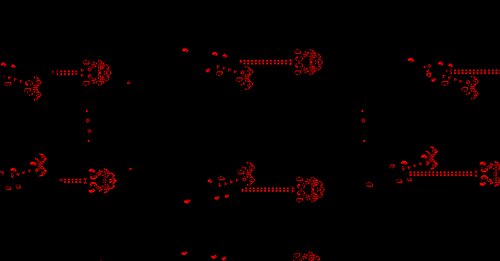
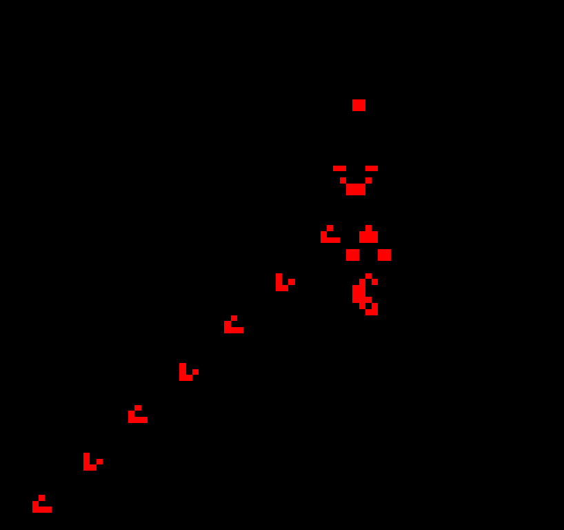

# Game of Life (OpenGL)

Conway's Game of Life simulation using OpenGL compute shaders for GPU-accelerated cell updates.

## Features

- GPU-accelerated simulation with compute shaders
- Pan and zoom controls
- RLE pattern import from URLs
- Custom survival/birth rules
- Video playback support
- Audio playback

## Default Pattern

The application loads the [LWSS-breeder pattern](https://copy.sh/life/examples/LWSS-breeder.rle) by default

## Screenshots

## Dependencies

- **GLFW** - Window and input management
- **GLAD** - OpenGL loader
- **GLM** - OpenGL mathematics library
- **OpenGL** - Graphics API (version 3.3 core profile)
- **OpenCV** - Video processing
- **irrKlang** - Audio engine
- **libcurl** - HTTP requests for pattern downloading

## Building

### Prerequisites

- Windows with Visual Studio
- All dependencies linked in `gameoflife/lib/`

### Build Steps

1. Open `gameoflife.sln` in Visual Studio
2. Build the solution in Release or Debug mode

## Controls

- Mouse drag: Pan camera
- Mouse scroll: Zoom
- ESC: Exit
- B: Play Bad Apple animation
